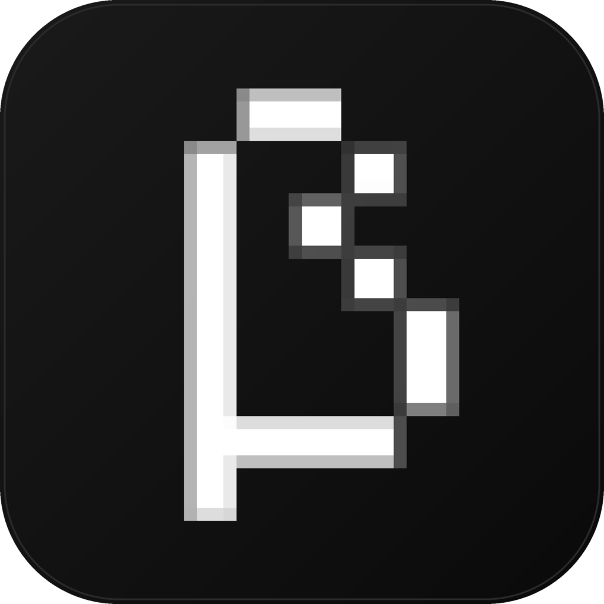

  

BerserkMC
=========

BerserkMC is a custom launcher for Minecraft focused on predictability, long
term stability and simplicity, fork of the MultiMC project.

> **Offline-only fork.** Microsoft ("online") account login is disabled. Every
> account is a local, offline account identified by a player name only. See
> [Offline mode](#offline-mode).

This project is an independent fork. It is **not** affiliated with or endorsed
by the MultiMC project.

## Offline mode

BerserkMC is offline-only by design:

- **Singleplayer / LAN / mods** — works.
- **Servers with `online-mode=false`** — works. The server accepts the offline
  UUID derived from the player name.
- **Servers with `online-mode=true`** (most public servers) — **will not work**.
  The server asks Mojang's session server to verify the join token; an offline
  account has no token. This is a server-side check and cannot be worked around
  from the launcher.

Existing Microsoft accounts found in `accounts.json` are converted to offline
accounts automatically on startup. See [README.fork.md](README.fork.md) for the
full list of changes and the reasoning behind them.

## Building

Build instructions live in [BUILD.md](BUILD.md). BerserkMC targets Qt 5.15 with
the QML UI; the tested Windows toolchain is MSYS2 mingw-w64 + Qt 5 + Ninja.

## Translations

Translations can be contributed via the upstream Crowdin project. Avoid opening
pull requests that modify the translations repository directly.

## License

Copyright &copy; 2013-2022 MultiMC Contributors (upstream).

Licensed under the Apache License, Version 2.0 (the "License"); you may not use
this program except in compliance with the License. You may obtain a copy of the
License at [http://www.apache.org/licenses/LICENSE-2.0](http://www.apache.org/licenses/LICENSE-2.0).

Unless required by applicable law or agreed to in writing, software distributed
under the License is distributed on an "AS IS" BASIS, WITHOUT WARRANTIES OR
CONDITIONS OF ANY KIND, either express or implied. See the License for the
specific language governing permissions and limitations under the License.
See [COPYING.md](COPYING.md) for the full text and third-party notices.

## Forking / redistributing / custom builds policy

The upstream project keeps the Launcher open source under the Apache license so
that the source can be audited. The license gives you access to the source code,
but not:

- The name, logo and other branding.
- The API tokens required to talk to the services the launcher depends on.

Because of the nature of the agreements required to interact with the Microsoft
identity platform, the upstream source has been debranded and builds without a
product name by default. You must provide your own branding if you want to
distribute your own builds, and register your own app on Azure to handle
Microsoft account logins.

If you fork the project, a mention of its origins in the About dialog and the
license is acceptable. However, it should be abundantly clear that the project
is a fork *without* implying any endorsement by the MultiMC project.
